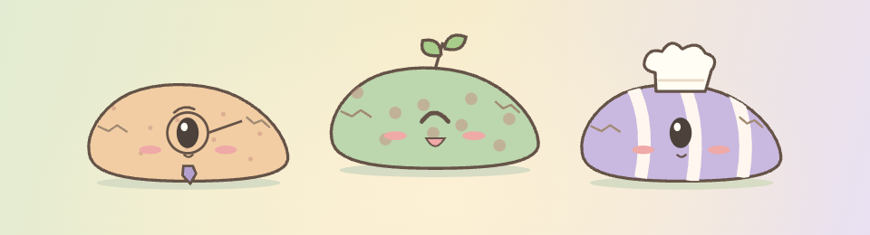
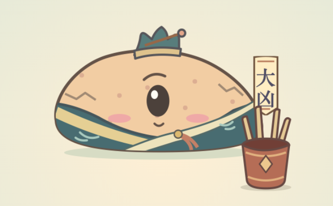
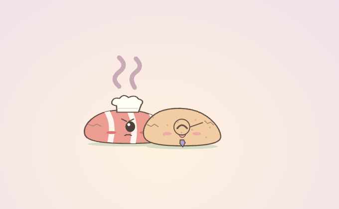

<div align="center">
  
  <h1>Little Oddlings</h1>
  <p>Three pocket-sized personalities, right on your Mac desktop.</p>
  <p><strong>English</strong> · <a href="README.zh-CN.md">简体中文</a> · <a href="README.zh-TW.md">繁體中文</a></p>
  <p><a href="https://github.com/Reditus-fish/little-oddlings/releases/latest"><strong>Download for Apple Silicon</strong></a> · <a href="#build-from-source">Build from source</a></p>
</div>

## Meet the Oddlings

**Miso** is a professional overthinker. **Moss** gets a little too excited to see you. **Pip** treats a small snack as an occasion for drama. Give one a corner of your screen and see how they settle in.

- **Stay or Follow.** Drag your pet to a spot on the desktop, or let it hop and scoot after your cursor. Hover over the pet for controls.
- **A little company.** Pat its shell or tap its face for different reactions. Share a snack, roll out a toy, or leave it alone to blink, stretch and doze.
- **Draw a fortune.** Your pet puts on a Taoist robe and shakes a stick from a bamboo cup. A lucky draw circles it twice. An unlucky one gets eaten in two bites.
- **Hidden scenes.** Some encounters turn into short, wordless animations. Here’s one moment you might see.

<p align="center">
  
  
</p>

The macOS app runs offline. Sound starts muted, pet progress stays on your Mac, and the app respects Reduce Motion. The fortune stick displays Chinese characters. The pets express themselves through movement and wordless sounds.

## Build from source

On macOS, install Node.js 22 or later and the Xcode Command Line Tools. Run this from the repository folder.

```sh
npm run desktop
```

Use `npm run desktop:build` to build the app without opening it. The app is built at `desktop-dist/Little Oddlings.app`. To try the browser preview, run `npm start` and open [the local pet page](http://127.0.0.1:4173/pet.html). Run `npm test` to check the project.

Found a bug or have a favorite reaction? Open a GitHub issue and tell us which Oddling you were playing with. [Contribution guide](CONTRIBUTING.md)

[MIT License](LICENSE)
