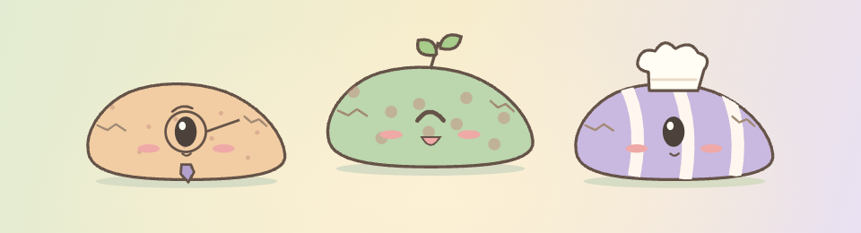
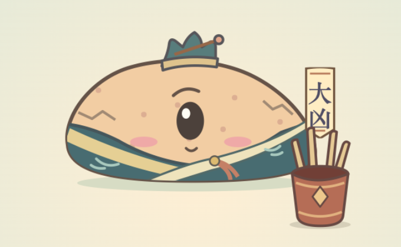
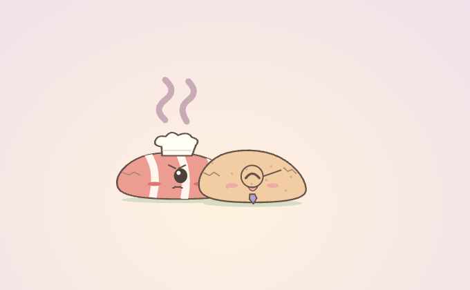

<div align="center">
  
  <h1>Little Oddlings · 桌面小伙伴</h1>
  <p>三只有自己小脾气的伙伴，住在你的 Mac 桌面上。</p>
  <p><a href="README.md">English</a> · <strong>简体中文</strong> · <a href="README.zh-TW.md">繁體中文</a></p>
  <p><a href="https://github.com/Reditus-fish/little-oddlings/releases/latest"><strong>下载 Apple 芯片版</strong></a> · <a href="#从源代码构建">从源代码构建</a></p>
</div>

## 认识三只小伙伴

**Miso** 凡事都要多想一会儿。**Moss** 一见到你就有点过于兴奋。**Pip** 连吃个点心都要演一出大戏。给它们留一块桌面角落，看看谁先趴下打盹。

- **原地待着，或跟随光标。** 把小伙伴拖到桌面上喜欢的位置，也可以让它跟着光标一蹦一爬。鼠标移到它身上就能看到工具栏。
- **陪它玩一会儿。** 摸摸壳或戳戳脸，反应各有不同。可以分享点心、滚个小球，也可以让它自己眨眼、伸懒腰、打瞌睡。
- **求签。** 小伙伴穿上道袍，从竹筒里摇出一支签。吉签绕着它飞两圈，凶签被它两口吃掉。
- **隐藏彩蛋。** 有些相遇会变成一小段无对白动画。下图是其中的一幕。

<p align="center">
  
  
</p>

macOS 版可离线运行，默认静音，养成进度保存在本机，并支持系统的减少动态效果设置。签文使用汉字，小伙伴靠动作和无语言音效表达情绪。

## 从源代码构建

在 macOS 上安装 Node.js 22 或更高版本，以及 Xcode 命令行工具。在仓库目录中运行下方命令。

```sh
npm run desktop
```

若只想构建应用，可以运行 `npm run desktop:build`。 应用位于 `desktop-dist/Little Oddlings.app`。想在浏览器里试试，可以运行 `npm start`，再打开[本地宠物页面](http://127.0.0.1:4173/pet.html)。运行 `npm test` 可执行测试。

发现问题，或特别喜欢某个反应？欢迎在 GitHub 提一个 Issue，告诉我们当时在陪哪一只玩。 [贡献指南](CONTRIBUTING.md)

[MIT 许可证](LICENSE)
