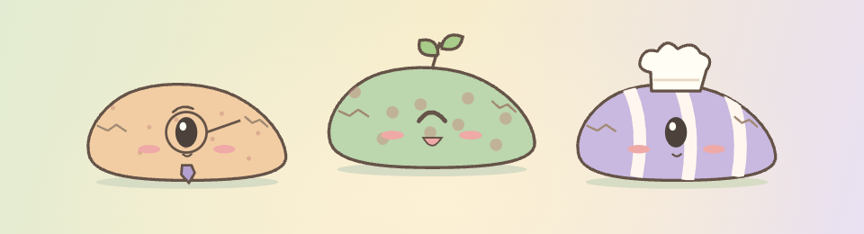
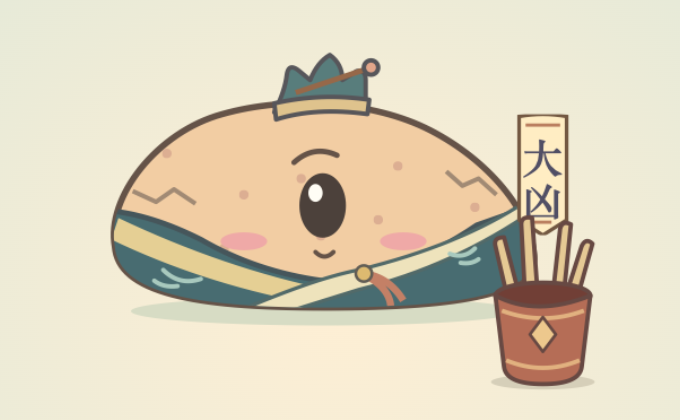
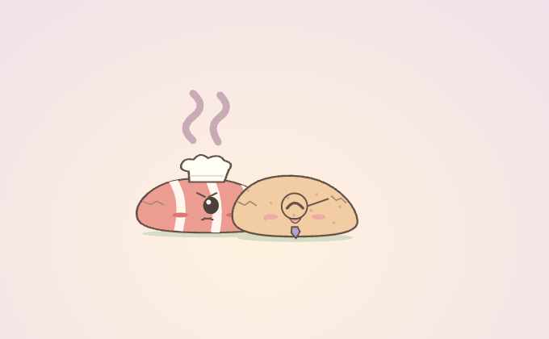

<div align="center">
  
  <h1>Little Oddlings · 桌面小夥伴</h1>
  <p>三隻各有小脾氣的夥伴，住在你的 Mac 桌面上。</p>
  <p><a href="README.md">English</a> · <a href="README.zh-CN.md">简体中文</a> · <strong>繁體中文</strong></p>
  <p><a href="https://github.com/Reditus-fish/little-oddlings/releases/latest"><strong>下載 Apple 晶片版</strong></a> · <a href="#從原始碼建置">從原始碼建置</a></p>
</div>

## 認識三隻小夥伴

**Miso** 凡事都要多想一會兒。**Moss** 一見到你就有點太興奮。**Pip** 連吃個點心都要演一齣大戲。給牠們留一個桌面角落，看看誰先趴下打盹。

- **留在原地，或跟隨游標。** 把小夥伴拖到桌面上喜歡的位置，也可以讓牠跟著游標一蹦一爬。游標移到牠身上就能看到工具列。
- **陪牠玩一會兒。** 摸摸殼或戳戳臉，反應各有不同。可以分享點心、滾個小球，也可以讓牠自己眨眼、伸懶腰、打瞌睡。
- **求籤。** 小夥伴穿上道袍，從竹筒裡搖出一支籤。吉籤繞著牠飛兩圈，凶籤被牠兩口吃掉。
- **隱藏彩蛋。** 有些相遇會變成一小段無對白動畫。下圖是其中的一幕。

<p align="center">
  
  
</p>

macOS 版可離線執行，預設靜音，養成進度儲存在本機，並支援系統的減少動態效果設定。籤文使用漢字，小夥伴靠動作和沒有語言的音效表達情緒。

## 從原始碼建置

在 macOS 上安裝 Node.js 22 或更新版本，以及 Xcode 命令列工具。在專案資料夾中執行下方指令。

```sh
npm run desktop
```

若只想建置應用程式，可以執行 `npm run desktop:build`。 應用程式位於 `desktop-dist/Little Oddlings.app`。想在瀏覽器試試，可以執行 `npm start`，再開啟[本機寵物頁面](http://127.0.0.1:4173/pet.html)。執行 `npm test` 可跑測試。

發現問題，或特別喜歡某個反應？歡迎在 GitHub 開一個 Issue，告訴我們當時在陪哪一隻玩。 [貢獻指南](CONTRIBUTING.md)

[MIT 授權條款](LICENSE)
